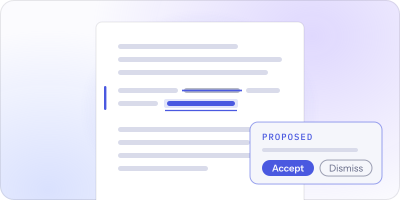
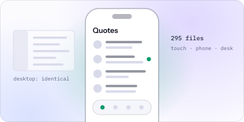
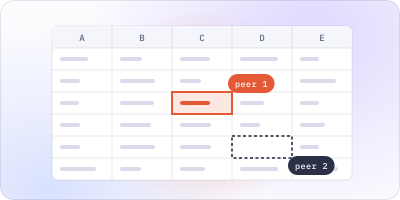
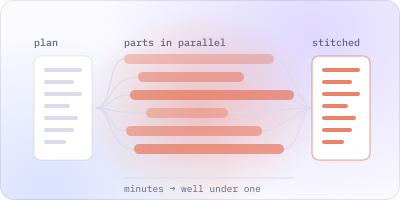
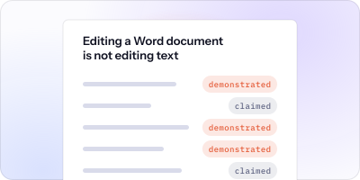
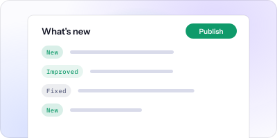
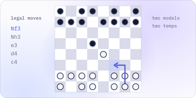
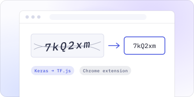

<h3 align="center">Founding engineer at <a href="https://usesidecar.com">Sidecar</a> · Bengaluru</h3>

Before [Sidecar](https://usesidecar.com), at [Metaforms](https://metaforms.ai), I owned survey programming, collaborative editing and agentic document tooling for a market-research platform. Most of what I build sits where people and agents work on the same thing at once: live documents, shared spreadsheets, and agents that propose changes for a person to accept.

<samp>[shiplog](https://d-z-v.github.io/) · [linkedin](https://www.linkedin.com/in/dev-bhandari/) · [oppia prs](https://github.com/oppia/oppia/pulls?q=is%3Apr+author%3AD-z-V+is%3Amerged)</samp>

### Selected work

<table>
<tr>
<td width="50%" valign="top">
<a href="https://d-z-v.github.io/#e20"><picture><source media="(prefers-color-scheme: dark)" srcset="./assets/work-docx-studio-dark.svg"><source media="(prefers-color-scheme: light)" srcset="./assets/work-docx-studio-light.svg"></picture></a>
 <samp>SIDE PROJECT · 2026</samp> 
<a href="https://d-z-v.github.io/#e20"><b>docx-studio</b></a> 
An agent that edits Word but can only propose. Every change is a real tracked change, checked against the saved file.
</td>
<td width="50%" valign="top">
<a href="https://d-z-v.github.io/#e26"><picture><source media="(prefers-color-scheme: dark)" srcset="./assets/work-phone-dark.svg"><source media="(prefers-color-scheme: light)" srcset="./assets/work-phone-light.svg"></picture></a>
 <samp>SIDECAR · 2026</samp> 
<a href="https://d-z-v.github.io/#e26"><b>Sidecar on a phone</b></a> 
The whole dashboard as a touch app. 295 files changed, and the desktop screenshots stayed byte-identical.
</td>
</tr>
<tr>
<td width="50%" valign="top">
<a href="https://d-z-v.github.io/#e15"><picture><source media="(prefers-color-scheme: dark)" srcset="./assets/work-crdt-sheet-dark.svg"><source media="(prefers-color-scheme: light)" srcset="./assets/work-crdt-sheet-light.svg"></picture></a>
 <samp>METAFORMS · 2026</samp> 
<a href="https://d-z-v.github.io/#e15"><b>A spreadsheet everyone edits at once</b></a> 
A Univer plugin that turns every sheet mutation into a CRDT op and replays it on every peer.
</td>
<td width="50%" valign="top">
<a href="https://d-z-v.github.io/#e22"><picture><source media="(prefers-color-scheme: dark)" srcset="./assets/work-parallel-dark.svg"><source media="(prefers-color-scheme: light)" srcset="./assets/work-parallel-light.svg"></picture></a>
 <samp>METAFORMS · 2026</samp> 
<a href="https://d-z-v.github.io/#e22"><b>A questionnaire, designed in parallel</b></a> 
Sections split into ten-question parts and designed at the same time. The build went from minutes to well under one.
</td>
</tr>
<tr>
<td width="50%" valign="top">
<a href="https://d-z-v.github.io/#e18"><picture><source media="(prefers-color-scheme: dark)" srcset="./assets/work-docx-paper-dark.svg"><source media="(prefers-color-scheme: light)" srcset="./assets/work-docx-paper-light.svg"></picture></a>
 <samp>METAFORMS · 2026</samp> 
<a href="https://d-z-v.github.io/#e18"><b>Editing a Word document is not editing text</b></a> 
A paper on agentic tracked-change editing of .docx, every claim tagged demonstrated or claimed.
</td>
<td width="50%" valign="top">
<a href="https://d-z-v.github.io/#e23"><picture><source media="(prefers-color-scheme: dark)" srcset="./assets/work-help-dark.svg"><source media="(prefers-color-scheme: light)" srcset="./assets/work-help-light.svg"></picture></a>
 <samp>SIDECAR · 2026</samp> 
<a href="https://d-z-v.github.io/#e23"><b>Docs that write themselves</b></a> 
A help center where publishing a change writes its own release note.
</td>
</tr>
<tr>
<td width="50%" valign="top">
<a href="https://github.com/D-z-V/llm-chess"><picture><source media="(prefers-color-scheme: dark)" srcset="./assets/work-chess-dark.svg"><source media="(prefers-color-scheme: light)" srcset="./assets/work-chess-light.svg"></picture></a>
 <samp>SIDE PROJECT · 2025</samp> 
<a href="https://github.com/D-z-V/llm-chess"><b>llm-chess</b></a> 
Two language models play chess, every move constrained by a legal-move grammar. <a href="https://llm-chess-olive.vercel.app/">Play it</a>.
</td>
<td width="50%" valign="top">
<a href="https://github.com/D-z-V/IRCTC-nlpCaptcha-Solver"><picture><source media="(prefers-color-scheme: dark)" srcset="./assets/work-captcha-dark.svg"><source media="(prefers-color-scheme: light)" srcset="./assets/work-captcha-light.svg"></picture></a>
 <samp>SIDE PROJECT · 2022</samp> 
<a href="https://github.com/D-z-V/IRCTC-nlpCaptcha-Solver"><b>IRCTC captcha solver</b></a> 
A Keras model, converted to TensorFlow.js, running inside a Chrome extension that fills the railway booking captcha.
</td>
</tr>
</table>

### Open source

Six merged pull requests to [Oppia](https://github.com/oppia/oppia), January to April 2025, in a large Angular codebase:
[A new donate-page carousel](https://github.com/oppia/oppia/pull/21560) · [Tab order after the audio bar expands](https://github.com/oppia/oppia/pull/21847) · [An unhandled promise on signup](https://github.com/oppia/oppia/pull/21996) · [The space after punctuation](https://github.com/oppia/oppia/pull/22114) · [Image-uploader flakes](https://github.com/oppia/oppia/pull/22264) · [Question-submitter acceptance tests](https://github.com/oppia/oppia/pull/22316).

### Hackathons

**[Social CBT](https://github.com/D-z-V/TRINIT_Cyberpunk_DEV3)** <samp>TRI-NIT · 2024</samp> 
A scanned question paper in, a timed exam out: OCR reads the page, an LLM structures it in LaTeX, and a JEE-style portal runs it.

**[energy-feed](https://github.com/D-z-V/energy-feed)** <samp>2023</samp> 
A news feed for the energy sector, with summaries generated once and stored.

 

Four years of shipping, one entry at a time, on the <a href="https://d-z-v.github.io/">shiplog</a>.

